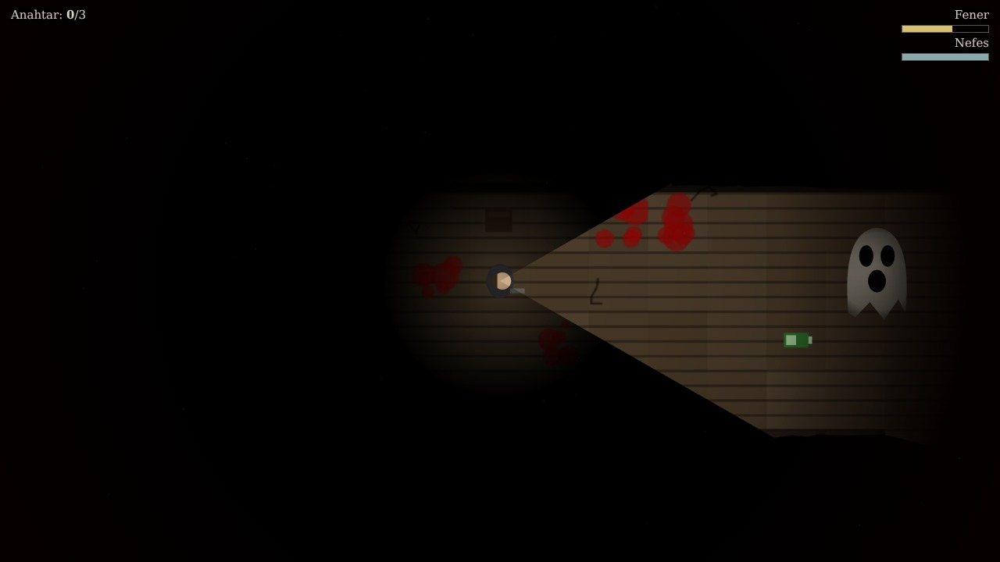

# Karanlık Ev

Gece yarısı. Kapı arkandan kilitlendi. Bu evde senden başka biri daha var.

Karanlık bir evde sadece fenerinle dolaşıp **3 anahtarı** topla ve **çıkış kapısına** ulaş. Ev boyunca seni bir hayalet avlıyor.

🎬 **Tanıtım videosu:** [trailer/karanlik-ev-fragman.mp4](trailer/karanlik-ev-fragman.mp4)

## İndir

Sağdaki **Releases** bölümünden en son sürümü aç, `KaranlikEv.apk` dosyasını telefona indirip kur. İlk kurulumda "bilinmeyen kaynaklara izin ver" demen gerekebilir.

## Nasıl oynanır

- **Ekranın sol tarafı:** parmağını sürükleyerek yürü (fener gittiğin yöne bakar)
- **KOŞ düğmesi:** koş, ama ses çıkarırsın ve hayalet duyar; nefesin de biter
- **Feneri hayalete tut:** ışıkta yavaşlar
- **Pil:** fener zamanla söner, yerdeki yeşil pilleri topla
- Her anahtar aldığında hayalet biraz daha hızlanır
- Kulaklıkla oyna: kalp atışın hayalet yaklaştıkça hızlanır

Bilgisayarda denemek için `www/index.html` dosyasını tarayıcıda aç (WASD + Shift).

## Proje

- `www/` oyunun kendisi (HTML5 canvas, harici dosya yok, tüm ses ve grafikler kodla üretiliyor)
- `.github/workflows/android.yml` her güncellemede APK'yı otomatik derler (Capacitor)
- `trailer/` tanıtım videosu ve onu üreten betikler
